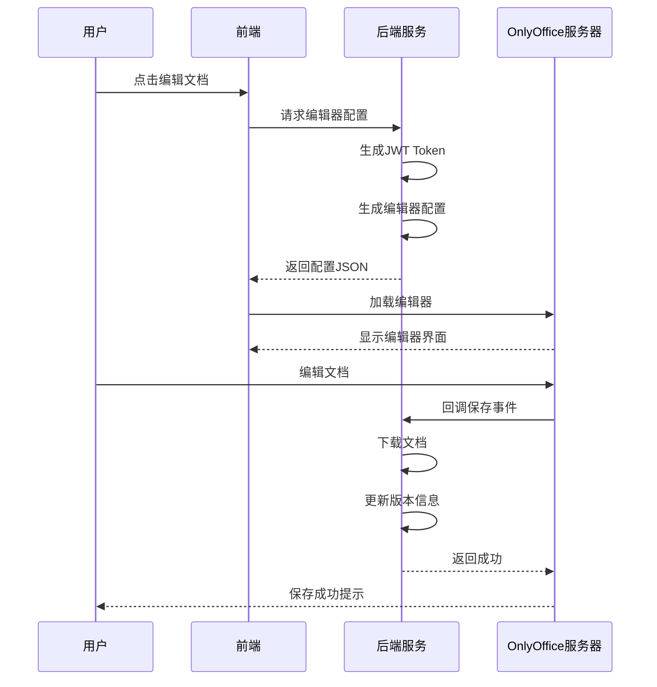
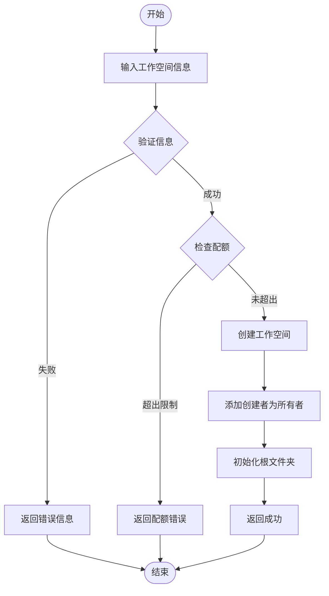
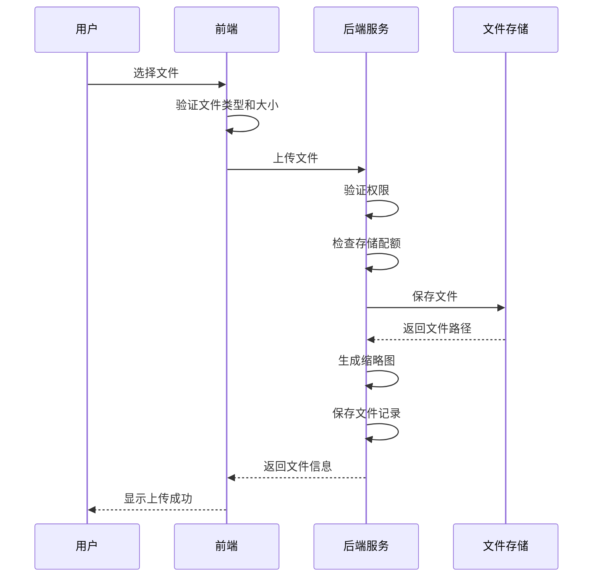
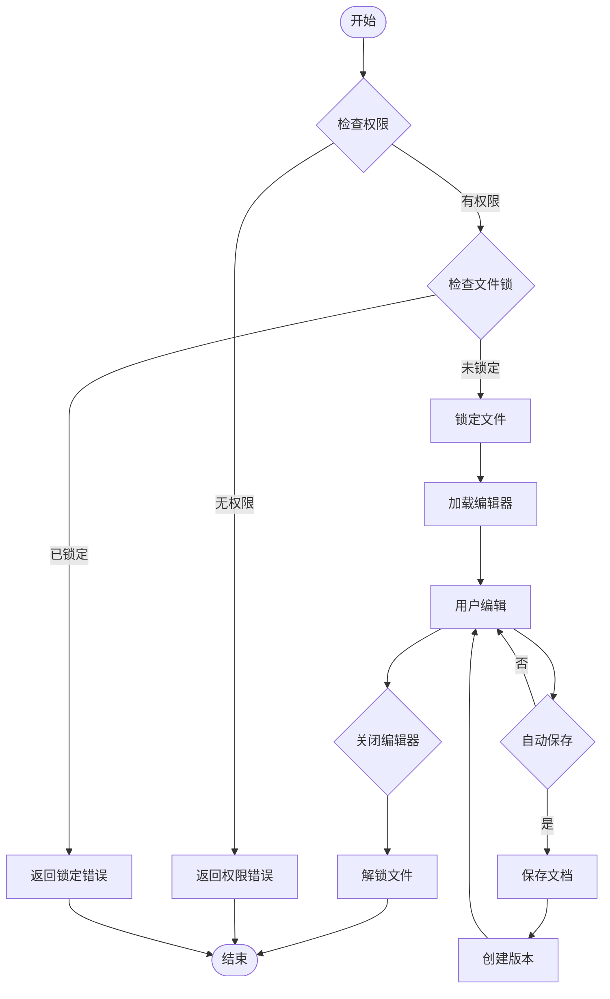
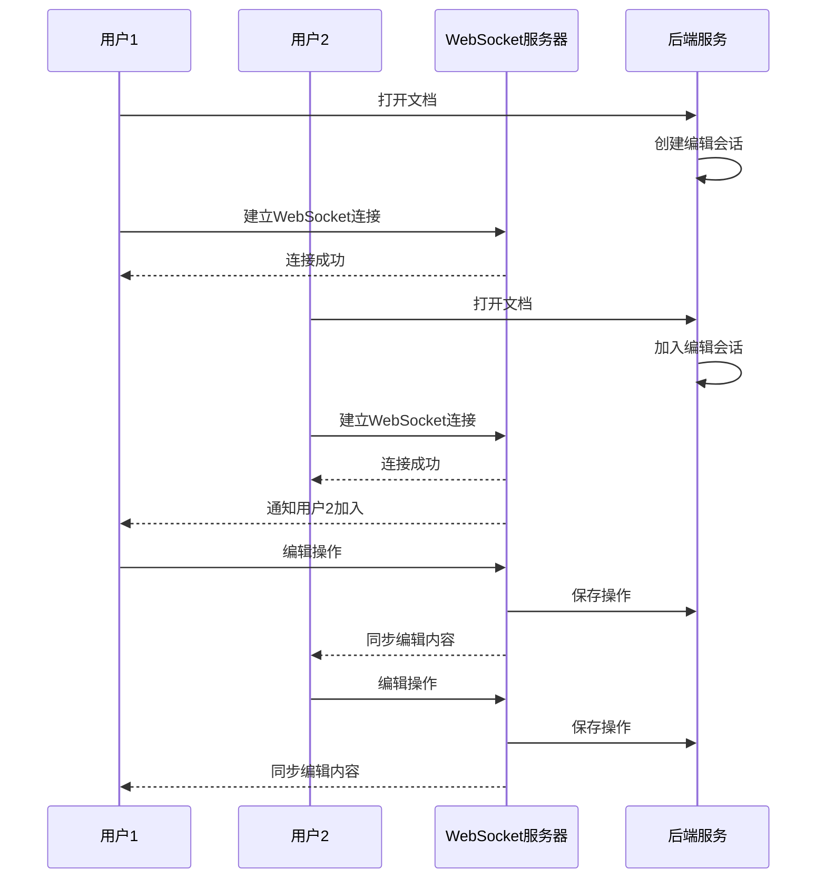
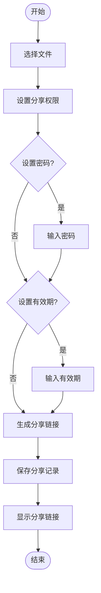
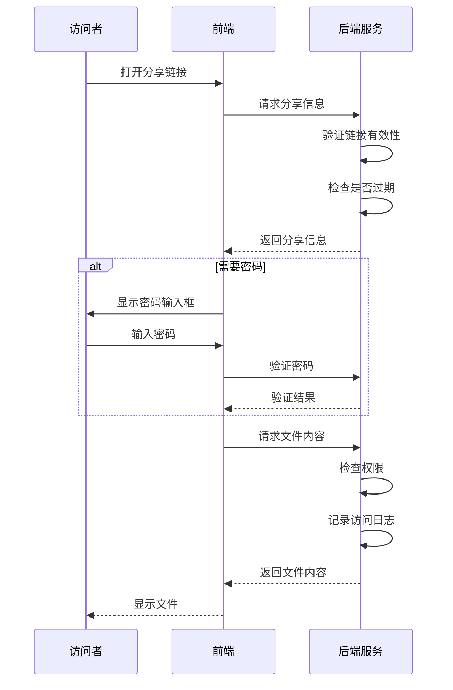
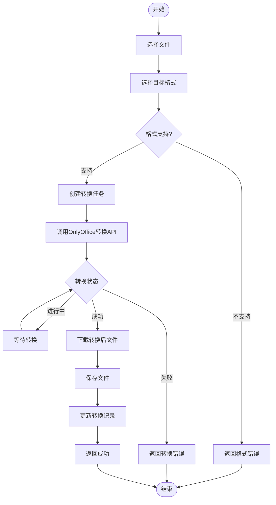
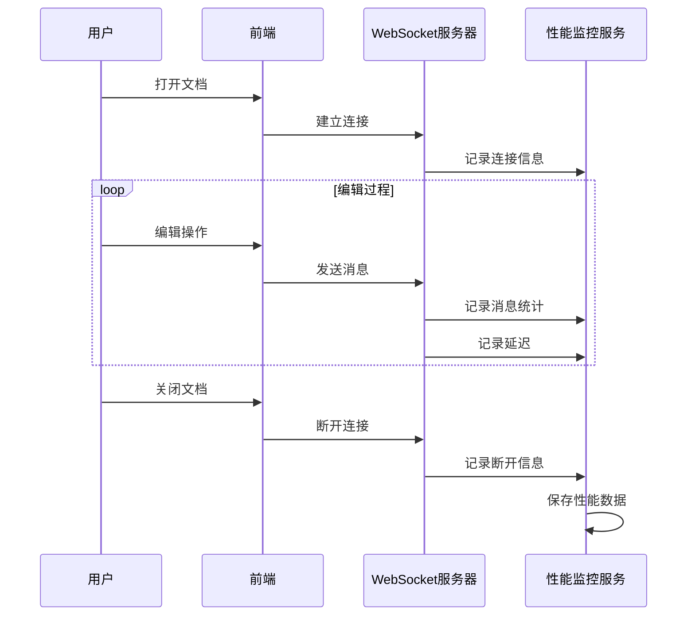
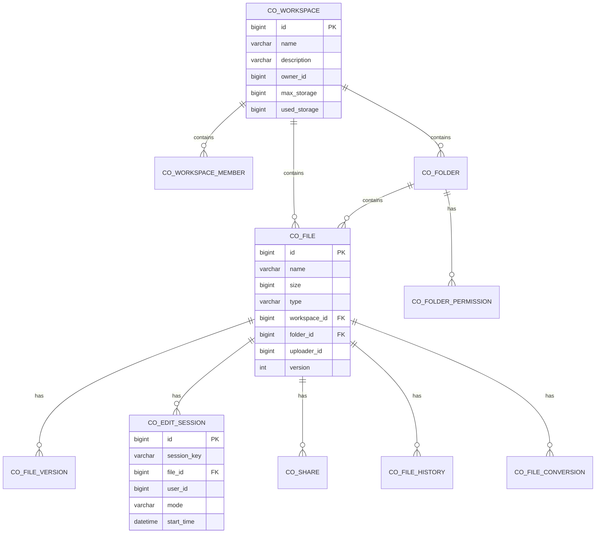

# RuoYi-coEdit 协同编辑系统设计说明书

**版本**: v1.23.0  
**日期**: 2025-11-05  
**作者**: zuleed  
**状态**: 已完成

---

## 📑 目录

1. [系统概述](#1-系统概述)
2. [技术架构](#2-技术架构)
3. [功能模块](#3-功能模块)
   - 3.1 [基础搭建模块](#31-基础搭建模块)
   - 3.2 [存储管理模块](#32-存储管理模块)
   - 3.3 [文件管理模块](#33-文件管理模块)
   - 3.4 [文档编辑模块](#34-文档编辑模块)
   - 3.5 [协同功能模块](#35-协同功能模块)
   - 3.6 [共享功能模块](#36-共享功能模块)
   - 3.7 [扩展功能模块](#37-扩展功能模块)
4. [API接口文档](#4-api接口文档)
5. [数据库设计](#5-数据库设计)
6. [使用概括](#6-使用概括)
7. [部署说明](#7-部署说明)
8. [附录](#8-附录)

---

## 1. 系统概述

### 1.1 项目背景

RuoYi-coEdit 是基于 RuoYi-Vue-Plus 框架和 OnlyOffice Document Server 9.1.0 EE 开发的企业级多人协同编辑系统。该系统旨在为企业提供完整的在线文档编辑、协同办公、文件管理解决方案。

### 1.2 核心特性

- ✅ **多人实时协同编辑**：支持多人同时编辑同一文档，实时同步编辑内容
- ✅ **完整的文件管理**：支持文件上传、下载、预览、版本管理、回收站等功能
- ✅ **工作空间管理**：支持创建工作空间、成员管理、权限控制
- ✅ **文档历史追踪**：完整的文档版本历史、变更记录、版本对比
- ✅ **文档转换服务**：支持50+种文档格式互转
- ✅ **性能监控**：实时监控编辑性能、连接状态、设备信息
- ✅ **安全认证**：JWT Token认证、权限控制、访问验证
- ✅ **移动端支持**：响应式设计、移动端优化、SockJS降级支持

### 1.3 系统目标

- **高可用性**：7x24小时稳定运行，支持高并发访问
- **高性能**：毫秒级响应，流畅的编辑体验
- **高安全性**：完善的权限控制、数据加密、访问审计
- **易用性**：简洁的界面、友好的交互、完善的文档

### 1.4 适用场景

- 企业内部文档协作
- 团队项目文档管理
- 在线教育文档编辑
- 政府公文处理
- 合同协议起草

---

## 2. 技术架构

### 2.1 技术栈

#### 后端技术
- **框架**: Spring Boot 3.0.6
- **ORM**: MyBatis Plus 3.5.3
- **安全**: Sa-Token 1.34.0
- **WebSocket**: Spring WebSocket + STOMP
- **HTTP客户端**: Apache HttpClient 5
- **JWT**: jjwt 0.11.5
- **数据库**: MySQL 8.0+
- **文档服务器**: OnlyOffice Document Server 9.1.0 EE

#### 前端技术
- **框架**: Vue 3
- **UI组件**: Element Plus
- **WebSocket客户端**: SockJS + STOMP.js
- **HTTP客户端**: Axios

### 2.2 系统架构图

```
┌─────────────────────────────────────────────────────────────┐
│                        客户端层                              │
│  ┌──────────┐  ┌──────────┐  ┌──────────┐  ┌──────────┐   │
│  │ Web浏览器 │  │ 移动浏览器 │  │  桌面端  │  │  移动端  │   │
│  └──────────┘  └──────────┘  └──────────┘  └──────────┘   │
└─────────────────────────────────────────────────────────────┘
                            ↓ HTTPS/WSS
┌─────────────────────────────────────────────────────────────┐
│                        网关层                                │
│              ┌──────────────────────────┐                   │
│              │   RuoYi Gateway (Nginx)  │                   │
│              └──────────────────────────┘                   │
└─────────────────────────────────────────────────────────────┘
                            ↓
┌─────────────────────────────────────────────────────────────┐
│                        应用层                                │
│  ┌──────────────────┐  ┌──────────────────┐               │
│  │  RuoYi-coEdit    │  │  OnlyOffice      │               │
│  │  微服务模块       │  │  Document Server │               │
│  │                  │  │                  │               │
│  │ - Controller     │  │ - Editor         │               │
│  │ - Service        │  │ - Converter      │               │
│  │ - WebSocket      │  │ - Command API    │               │
│  └──────────────────┘  └──────────────────┘               │
└─────────────────────────────────────────────────────────────┘
                            ↓
┌─────────────────────────────────────────────────────────────┐
│                        数据层                                │
│  ┌──────────┐  ┌──────────┐  ┌──────────┐                 │
│  │  MySQL   │  │  Redis   │  │  文件存储 │                 │
│  │  数据库   │  │  缓存    │  │  (本地)   │                 │
│  └──────────┘  └──────────┘  └──────────┘                 │
└─────────────────────────────────────────────────────────────┘
```

### 2.3 核心组件

#### 2.3.1 OnlyOffice集成组件
- **OnlyOfficeConfig**: OnlyOffice配置管理
- **OnlyOfficeService**: OnlyOffice API服务封装
- **JwtTokenUtil**: JWT Token生成和验证

#### 2.3.2 WebSocket组件
- **WebSocketConfig**: WebSocket配置
- **WebSocketConnectionManager**: 连接管理器
- **WebSocketEventListener**: 事件监听器

#### 2.3.3 文件管理组件
- **FileService**: 文件管理服务
- **FileVersionService**: 版本管理服务
- **RecycleBinService**: 回收站服务

#### 2.3.4 权限控制组件
- **WorkspacePermissionAspect**: 工作空间权限切面
- **FolderPermissionService**: 文件夹权限服务

---

## 3. 功能模块

### 3.1 基础搭建模块

#### 3.1.1 功能列表

| 功能编号 | 功能名称 | 功能描述 | 优先级 |
|---------|---------|---------|--------|
| F1.1 | OnlyOffice集成 | 集成OnlyOffice Document Server，提供文档编辑能力 | 高 |
| F1.2 | JWT认证 | 实现JWT Token认证机制，保证API调用安全 | 高 |
| F1.3 | 编辑器配置 | 生成OnlyOffice编辑器配置，支持自定义配置 | 高 |
| F1.4 | 回调处理 | 处理OnlyOffice回调事件，同步文档状态 | 高 |
| F1.5 | 健康检查 | 提供系统健康检查接口，监控服务状态 | 中 |

#### 3.1.2 功能描述

**F1.1 OnlyOffice集成**
- 配置OnlyOffice Document Server连接信息
- 支持文档编辑、查看、评论等模式
- 支持Word、Excel、PowerPoint等多种文档格式
- 提供文档编辑器嵌入页面

**F1.2 JWT认证**
- 使用HMAC-SHA256算法签名JWT Token
- Token有效期1小时，支持自定义
- 验证OnlyOffice API调用的合法性
- 防止未授权访问和篡改

**F1.3 编辑器配置**
- 生成编辑器配置JSON
- 支持自定义编辑器界面
- 支持自定义工具栏按钮
- 支持自定义回调URL

**F1.4 回调处理**
- 处理文档保存事件
- 处理文档关闭事件
- 处理文档强制保存事件
- 同步文档版本信息

#### 3.1.3 相关接口

| 接口名称 | 请求方法 | 路径 | 说明 |
|---------|---------|------|------|
| 获取编辑器配置 | GET | `/coedit/editor/config/{fileId}` | 获取文档编辑器配置 |
| 处理编辑器回调 | POST | `/coedit/editor/callback` | 处理OnlyOffice回调 |
| 健康检查 | GET | `/coedit/health` | 检查服务健康状态 |
| 测试OnlyOffice连接 | GET | `/coedit/test/connection` | 测试OnlyOffice连接 |

#### 3.1.4 业务流程图

**文档编辑流程**



---

### 3.2 存储管理模块

#### 3.2.1 功能列表

| 功能编号 | 功能名称 | 功能描述 | 优先级 |
|---------|---------|---------|--------|
| F2.1 | 工作空间管理 | 创建、编辑、删除工作空间 | 高 |
| F2.2 | 成员管理 | 添加、移除工作空间成员 | 高 |
| F2.3 | 角色管理 | 管理成员角色（所有者、管理员、成员、访客） | 高 |
| F2.4 | 权限控制 | 基于角色的权限控制 | 高 |
| F2.5 | 存储配额 | 管理工作空间存储配额 | 中 |

#### 3.2.2 功能描述

**F2.1 工作空间管理**
- 创建工作空间，设置名称、描述、图标
- 编辑工作空间信息
- 删除工作空间（软删除）
- 查询工作空间列表
- 工作空间统计（文件数、成员数、存储使用量）

**F2.2 成员管理**
- 邀请成员加入工作空间
- 移除工作空间成员
- 查看成员列表
- 成员搜索和筛选
- 批量操作成员

**F2.3 角色管理**
- **所有者（Owner）**: 拥有所有权限
- **管理员（Admin）**: 管理成员、文件、设置
- **成员（Member）**: 编辑文件、创建文件夹
- **访客（Guest）**: 仅查看权限

**F2.4 权限控制**
- 基于角色的访问控制（RBAC）
- 工作空间级别权限
- 文件夹级别权限
- 文件级别权限
- 权限继承机制

#### 3.2.3 相关接口

| 接口名称 | 请求方法 | 路径 | 说明 |
|---------|---------|------|------|
| 创建工作空间 | POST | `/coedit/workspace` | 创建新工作空间 |
| 更新工作空间 | PUT | `/coedit/workspace/{id}` | 更新工作空间信息 |
| 删除工作空间 | DELETE | `/coedit/workspace/{id}` | 删除工作空间 |
| 查询工作空间列表 | GET | `/coedit/workspace/list` | 分页查询工作空间 |
| 添加成员 | POST | `/coedit/workspace/{id}/member` | 添加工作空间成员 |
| 移除成员 | DELETE | `/coedit/workspace/{id}/member/{userId}` | 移除工作空间成员 |
| 更新成员角色 | PUT | `/coedit/workspace/{id}/member/{userId}/role` | 更新成员角色 |
| 查询成员列表 | GET | `/coedit/workspace/{id}/members` | 查询工作空间成员 |

#### 3.2.4 业务流程图

**工作空间创建流程**



### 3.3 文件管理模块

#### 3.3.1 功能列表

| 功能编号 | 功能名称 | 功能描述 | 优先级 |
|---------|---------|---------|--------|
| F3.1 | 文件上传 | 支持单文件、多文件上传 | 高 |
| F3.2 | 文件下载 | 支持文件下载、批量下载 | 高 |
| F3.3 | 文件预览 | 支持在线预览多种格式文件 | 高 |
| F3.4 | 文件夹管理 | 创建、重命名、移动、删除文件夹 | 高 |
| F3.5 | 文件搜索 | 全文搜索、高级搜索 | 中 |
| F3.6 | 回收站 | 文件回收、恢复、永久删除 | 中 |
| F3.7 | 文件版本 | 版本历史、版本对比、版本恢复 | 高 |

#### 3.3.2 功能描述

**F3.1 文件上传**
- 支持拖拽上传
- 支持断点续传
- 文件类型验证
- 文件大小限制
- 存储空间检查
- 自动生成缩略图

**F3.2 文件下载**
- 单文件下载
- 批量下载（ZIP压缩）
- 下载权限验证
- 下载次数统计
- 下载速度限制

**F3.3 文件预览**
- 支持Word、Excel、PowerPoint预览
- 支持PDF预览
- 支持图片预览
- 支持视频预览
- 水印功能
- 预览缓存

**F3.4 文件夹管理**
- 创建多级文件夹
- 文件夹重命名
- 文件夹移动
- 文件夹复制
- 文件夹删除（移至回收站）
- 文件夹权限设置

**F3.5 文件搜索**
- 按文件名搜索
- 按文件类型搜索
- 按创建时间搜索
- 按修改时间搜索
- 按文件大小搜索
- 全文搜索（文档内容）

**F3.6 回收站**
- 删除文件移至回收站
- 回收站文件列表
- 恢复文件
- 永久删除文件
- 清空回收站
- 自动清理（30天）

**F3.7 文件版本**
- 自动保存版本
- 版本列表查看
- 版本对比
- 版本恢复
- 版本删除
- 版本下载

#### 3.3.3 相关接口

| 接口名称 | 请求方法 | 路径 | 说明 |
|---------|---------|------|------|
| 上传文件 | POST | `/coedit/file/upload` | 上传文件 |
| 下载文件 | GET | `/coedit/file/download/{id}` | 下载文件 |
| 预览文件 | GET | `/coedit/file/preview/{id}` | 预览文件 |
| 创建文件夹 | POST | `/coedit/folder` | 创建文件夹 |
| 搜索文件 | GET | `/coedit/file/search` | 搜索文件 |
| 移至回收站 | DELETE | `/coedit/file/{id}` | 删除文件 |
| 恢复文件 | POST | `/coedit/recycle/{id}/restore` | 恢复文件 |
| 获取版本列表 | GET | `/coedit/file/{id}/versions` | 获取文件版本 |

#### 3.3.4 业务流程图

**文件上传流程**



---

### 3.4 文档编辑模块

#### 3.4.1 功能列表

| 功能编号 | 功能名称 | 功能描述 | 优先级 |
|---------|---------|---------|--------|
| F4.1 | 在线编辑 | 支持Word、Excel、PowerPoint在线编辑 | 高 |
| F4.2 | 编辑器配置 | 自定义编辑器界面和功能 | 高 |
| F4.3 | 自动保存 | 自动保存编辑内容 | 高 |
| F4.4 | 版本管理 | 管理文档版本 | 高 |
| F4.5 | 评论功能 | 支持文档评论 | 中 |
| F4.6 | 修订模式 | 支持修订模式编辑 | 中 |

#### 3.4.2 功能描述

**F4.1 在线编辑**
- 支持Word文档编辑（.docx, .doc）
- 支持Excel表格编辑（.xlsx, .xls）
- 支持PowerPoint演示文稿编辑（.pptx, .ppt）
- 支持PDF查看和注释
- 富文本编辑功能
- 格式化工具

**F4.2 编辑器配置**
- 自定义工具栏
- 自定义菜单
- 自定义快捷键
- 自定义界面主题
- 自定义语言
- 自定义插件

**F4.3 自动保存**
- 定时自动保存（可配置间隔）
- 编辑状态检测
- 保存失败重试
- 保存状态提示
- 离线编辑支持

**F4.4 版本管理**
- 自动创建版本
- 手动创建版本
- 版本标记（重要版本）
- 版本说明
- 版本对比
- 版本恢复

#### 3.4.3 相关接口

| 接口名称 | 请求方法 | 路径 | 说明 |
|---------|---------|------|------|
| 打开编辑器 | GET | `/coedit/editor/open/{fileId}` | 打开文档编辑器 |
| 保存文档 | POST | `/coedit/editor/save` | 保存文档 |
| 创建版本 | POST | `/coedit/file/{id}/version` | 创建文档版本 |
| 版本对比 | GET | `/coedit/file/{id}/compare` | 对比文档版本 |

#### 3.4.4 业务流程图

**文档编辑流程**



---

### 3.5 协同功能模块

#### 3.5.1 功能列表

| 功能编号 | 功能名称 | 功能描述 | 优先级 |
|---------|---------|---------|--------|
| F5.1 | 多人协同编辑 | 支持多人同时编辑同一文档 | 高 |
| F5.2 | 实时同步 | 实时同步编辑内容 | 高 |
| F5.3 | 在线用户列表 | 显示当前在线编辑用户 | 高 |
| F5.4 | 光标位置同步 | 显示其他用户光标位置 | 中 |
| F5.5 | 冲突处理 | 处理编辑冲突 | 高 |
| F5.6 | 编辑日志 | 记录编辑操作日志 | 中 |

#### 3.5.2 功能描述

**F5.1 多人协同编辑**
- 支持多人同时编辑
- 实时显示其他用户编辑内容
- 用户颜色标识
- 用户头像显示
- 编辑权限控制

**F5.2 实时同步**
- WebSocket实时通信
- 操作增量同步
- 断线重连
- 同步状态提示
- 网络状态检测

**F5.3 在线用户列表**
- 显示当前在线用户
- 用户状态（编辑中、查看中）
- 用户进入/离开提示
- 用户操作统计

**F5.4 光标位置同步**
- 显示其他用户光标
- 光标颜色区分
- 光标位置实时更新
- 选中内容高亮

**F5.5 冲突处理**
- 自动合并编辑
- 冲突检测
- 冲突解决策略
- 冲突提示

**F5.6 编辑日志**
- 记录用户操作
- 记录编辑时间
- 记录编辑内容
- 操作回放

#### 3.5.3 相关接口

| 接口名称 | 请求方法 | 路径 | 说明 |
|---------|---------|------|------|
| 创建编辑会话 | POST | `/coedit/session/create` | 创建编辑会话 |
| 结束编辑会话 | POST | `/coedit/session/end` | 结束编辑会话 |
| 获取在线用户 | GET | `/coedit/session/{fileId}/users` | 获取在线用户 |
| 发送编辑消息 | WS | `/app/edit` | 发送编辑消息 |
| 订阅文件更新 | WS | `/topic/file/{fileId}` | 订阅文件更新 |

#### 3.5.4 业务流程图

**协同编辑流程**



### 3.6 共享功能模块

#### 3.6.1 功能列表

| 功能编号 | 功能名称 | 功能描述 | 优先级 |
|---------|---------|---------|--------|
| F6.1 | 分享链接 | 生成文件分享链接 | 高 |
| F6.2 | 权限设置 | 设置分享权限（查看、编辑、下载） | 高 |
| F6.3 | 访问密码 | 设置分享链接访问密码 | 中 |
| F6.4 | 有效期设置 | 设置分享链接有效期 | 中 |
| F6.5 | 访问统计 | 统计分享链接访问次数 | 低 |
| F6.6 | 访问日志 | 记录分享链接访问日志 | 低 |

#### 3.6.2 功能描述

**F6.1 分享链接**
- 生成唯一分享链接
- 支持文件和文件夹分享
- 链接复制功能
- 二维码生成
- 链接管理

**F6.2 权限设置**
- **仅查看**: 只能查看文件内容
- **可编辑**: 可以编辑文件
- **可下载**: 可以下载文件
- **可评论**: 可以添加评论
- 权限组合设置

**F6.3 访问密码**
- 设置访问密码
- 密码验证
- 密码修改
- 密码重置

**F6.4 有效期设置**
- 设置过期时间
- 永久有效
- 自定义有效期
- 过期自动失效

**F6.5 访问统计**
- 访问次数统计
- 访问用户统计
- 访问时间分布
- 访问地域分布

**F6.6 访问日志**
- 记录访问时间
- 记录访问IP
- 记录访问设备
- 记录访问操作

#### 3.6.3 相关接口

| 接口名称 | 请求方法 | 路径 | 说明 |
|---------|---------|------|------|
| 创建分享 | POST | `/coedit/share` | 创建分享链接 |
| 更新分享 | PUT | `/coedit/share/{id}` | 更新分享设置 |
| 删除分享 | DELETE | `/coedit/share/{id}` | 删除分享链接 |
| 访问分享 | GET | `/coedit/share/{shareCode}` | 访问分享链接 |
| 验证密码 | POST | `/coedit/share/{shareCode}/verify` | 验证访问密码 |
| 获取分享列表 | GET | `/coedit/share/list` | 获取分享列表 |

#### 3.6.4 业务流程图

**文件分享流程**



**访问分享流程**



---

### 3.7 扩展功能模块

#### 3.7.1 功能列表

| 功能编号 | 功能名称 | 功能描述 | 优先级 |
|---------|---------|---------|--------|
| F7.1 | 文件夹权限 | 设置文件夹级别权限 | 高 |
| F7.2 | 文件搜索 | 全文搜索和高级搜索 | 高 |
| F7.3 | 预览优化 | 优化文件预览性能 | 中 |
| F7.4 | 文档历史 | 文档历史和变更追踪 | 高 |
| F7.5 | 文档转换 | 多格式文档转换 | 中 |
| F7.6 | 性能监控 | 编辑性能监控 | 中 |

#### 3.7.2 功能描述

**F7.1 文件夹权限**
- 设置文件夹访问权限
- 权限继承机制
- 权限覆盖设置
- 批量权限设置
- 权限模板

**F7.2 文件搜索**
- 文件名搜索
- 全文搜索
- 高级搜索（多条件组合）
- 搜索历史
- 搜索建议
- 搜索结果高亮

**F7.3 预览优化**
- 预览缓存
- 缩略图生成
- 水印功能
- 预览配置
- 移动端适配

**F7.4 文档历史**
- 版本历史记录
- 变更追踪
- 版本对比
- 版本恢复
- 历史清理

**F7.5 文档转换**
- 支持50+种格式转换
- 批量转换
- 异步转换
- 转换进度查询
- 转换历史

**F7.6 性能监控**
- 连接状态监控
- 延迟监控
- 消息统计
- 错误统计
- 设备统计
- 网络统计

#### 3.7.3 相关接口

| 接口名称 | 请求方法 | 路径 | 说明 |
|---------|---------|------|------|
| 设置文件夹权限 | POST | `/coedit/folder/{id}/permission` | 设置文件夹权限 |
| 搜索文件 | GET | `/coedit/file/search` | 搜索文件 |
| 生成缩略图 | POST | `/coedit/file/{id}/thumbnail` | 生成缩略图 |
| 获取文档历史 | GET | `/coedit/history/file/{fileId}` | 获取文档历史 |
| 转换文档 | POST | `/coedit/convert/file` | 转换文档格式 |
| 获取性能统计 | GET | `/coedit/performance/stats/realtime` | 获取实时性能统计 |

#### 3.7.4 业务流程图

**文档转换流程**



**性能监控流程**



---

## 4. API接口文档

### 4.1 接口规范

#### 4.1.1 请求规范

**请求头**
```
Content-Type: application/json
Authorization: Bearer {token}
```

**请求参数**
- 路径参数：`/api/resource/{id}`
- 查询参数：`/api/resource?page=1&size=10`
- 请求体：JSON格式

#### 4.1.2 响应规范

**成功响应**
```json
{
  "code": 200,
  "msg": "操作成功",
  "data": {
    // 响应数据
  }
}
```

**错误响应**
```json
{
  "code": 500,
  "msg": "操作失败",
  "data": null
}
```

**分页响应**
```json
{
  "code": 200,
  "msg": "查询成功",
  "rows": [
    // 数据列表
  ],
  "total": 100
}
```

### 4.2 工作空间接口

#### 4.2.1 创建工作空间

**接口地址**: `POST /coedit/workspace`

**请求参数**:
```json
{
  "name": "我的工作空间",
  "description": "工作空间描述",
  "icon": "workspace-icon.png",
  "maxStorage": 10737418240
}
```

**响应示例**:
```json
{
  "code": 200,
  "msg": "创建成功",
  "data": {
    "id": 1,
    "name": "我的工作空间",
    "description": "工作空间描述",
    "icon": "workspace-icon.png",
    "ownerId": 1,
    "ownerName": "张三",
    "maxStorage": 10737418240,
    "usedStorage": 0,
    "memberCount": 1,
    "fileCount": 0,
    "createTime": "2025-11-05 10:00:00"
  }
}
```

#### 4.2.2 添加成员

**接口地址**: `POST /coedit/workspace/{id}/member`

**请求参数**:
```json
{
  "userId": 2,
  "role": "MEMBER"
}
```

**响应示例**:
```json
{
  "code": 200,
  "msg": "添加成功",
  "data": {
    "id": 1,
    "workspaceId": 1,
    "userId": 2,
    "userName": "李四",
    "role": "MEMBER",
    "joinTime": "2025-11-05 10:05:00"
  }
}
```

### 4.3 文件管理接口

#### 4.3.1 上传文件

**接口地址**: `POST /coedit/file/upload`

**请求参数**: `multipart/form-data`
```
file: 文件
workspaceId: 1
folderId: 1
```

**响应示例**:
```json
{
  "code": 200,
  "msg": "上传成功",
  "data": {
    "id": 1,
    "name": "文档.docx",
    "size": 1024000,
    "type": "docx",
    "path": "/upload/2025/11/05/xxx.docx",
    "workspaceId": 1,
    "folderId": 1,
    "uploaderId": 1,
    "uploaderName": "张三",
    "createTime": "2025-11-05 10:10:00"
  }
}
```

#### 4.3.2 搜索文件

**接口地址**: `GET /coedit/file/search`

**请求参数**:
```
keyword: 文档
workspaceId: 1
fileType: docx
startTime: 2025-11-01
endTime: 2025-11-05
page: 1
size: 10
```

**响应示例**:
```json
{
  "code": 200,
  "msg": "查询成功",
  "rows": [
    {
      "id": 1,
      "name": "重要文档.docx",
      "size": 1024000,
      "type": "docx",
      "workspaceId": 1,
      "folderId": 1,
      "uploaderId": 1,
      "uploaderName": "张三",
      "createTime": "2025-11-05 10:10:00"
    }
  ],
  "total": 1
}
```

### 4.4 文档编辑接口

#### 4.4.1 获取编辑器配置

**接口地址**: `GET /coedit/editor/config/{fileId}`

**响应示例**:
```json
{
  "code": 200,
  "msg": "获取成功",
  "data": {
    "documentType": "word",
    "document": {
      "fileType": "docx",
      "key": "file-key-123",
      "title": "文档.docx",
      "url": "http://example.com/file/download/1"
    },
    "editorConfig": {
      "mode": "edit",
      "lang": "zh-CN",
      "callbackUrl": "http://example.com/coedit/editor/callback",
      "user": {
        "id": "1",
        "name": "张三"
      }
    },
    "token": "eyJhbGciOiJIUzI1NiIsInR5cCI6IkpXVCJ9..."
  }
}
```

### 4.5 协同编辑接口

#### 4.5.1 创建编辑会话

**接口地址**: `POST /coedit/session/create`

**请求参数**:
```json
{
  "fileId": 1,
  "mode": "edit"
}
```

**响应示例**:
```json
{
  "code": 200,
  "msg": "创建成功",
  "data": {
    "sessionKey": "session-key-123",
    "fileId": 1,
    "userId": 1,
    "userName": "张三",
    "mode": "edit",
    "startTime": "2025-11-05 10:20:00"
  }
}
```

### 4.6 分享接口

#### 4.6.1 创建分享

**接口地址**: `POST /coedit/share`

**请求参数**:
```json
{
  "fileId": 1,
  "permission": "VIEW",
  "password": "123456",
  "expireTime": "2025-12-05 00:00:00"
}
```

**响应示例**:
```json
{
  "code": 200,
  "msg": "创建成功",
  "data": {
    "id": 1,
    "shareCode": "abc123",
    "shareUrl": "http://example.com/share/abc123",
    "fileId": 1,
    "fileName": "文档.docx",
    "permission": "VIEW",
    "hasPassword": true,
    "expireTime": "2025-12-05 00:00:00",
    "createTime": "2025-11-05 10:30:00"
  }
}
```

### 4.7 文档转换接口

#### 4.7.1 转换文档

**接口地址**: `POST /coedit/convert/file`

**请求参数**:
```json
{
  "fileId": 1,
  "targetFormat": "pdf"
}
```

**响应示例**:
```json
{
  "code": 200,
  "msg": "转换任务已创建",
  "data": {
    "id": 1,
    "fileId": 1,
    "fileName": "文档.docx",
    "sourceFormat": "docx",
    "targetFormat": "pdf",
    "status": 1,
    "statusDesc": "转换中",
    "progress": 0,
    "createTime": "2025-11-05 10:40:00"
  }
}
```

### 4.8 性能监控接口

#### 4.8.1 获取实时统计

**接口地址**: `GET /coedit/performance/stats/realtime`

**响应示例**:
```json
{
  "code": 200,
  "msg": "查询成功",
  "data": {
    "activeConnections": 10,
    "onlineUsers": 8,
    "totalMessages": 1500,
    "averageLatency": 45.5,
    "totalErrors": 2,
    "deviceDistribution": {
      "desktop": 6,
      "mobile": 2
    },
    "networkDistribution": {
      "wifi": 7,
      "4g": 1
    }
  }
}
```

## 5. 数据库设计

### 5.1 数据库表清单

| 序号 | 表名 | 说明 | 记录数估算 |
|------|------|------|-----------|
| 1 | co_workspace | 工作空间表 | 1000+ |
| 2 | co_workspace_member | 工作空间成员表 | 10000+ |
| 3 | co_file | 文件表 | 100000+ |
| 4 | co_file_version | 文件版本表 | 500000+ |
| 5 | co_folder | 文件夹表 | 10000+ |
| 6 | co_folder_permission | 文件夹权限表 | 50000+ |
| 7 | co_recycle_bin | 回收站表 | 50000+ |
| 8 | co_edit_session | 编辑会话表 | 100000+ |
| 9 | co_edit_log | 编辑日志表 | 1000000+ |
| 10 | co_share | 分享表 | 50000+ |
| 11 | co_share_access_log | 分享访问日志表 | 500000+ |
| 12 | co_file_history | 文件历史表 | 500000+ |
| 13 | co_file_change | 文件变更表 | 1000000+ |
| 14 | co_file_conversion | 文件转换表 | 100000+ |
| 15 | co_editor_performance | 编辑器性能监控表 | 1000000+ |

### 5.2 核心表结构

#### 5.2.1 工作空间表 (co_workspace)

```sql
CREATE TABLE `co_workspace` (
  `id` BIGINT(20) NOT NULL AUTO_INCREMENT COMMENT '工作空间ID',
  `name` VARCHAR(100) NOT NULL COMMENT '工作空间名称',
  `description` VARCHAR(500) DEFAULT NULL COMMENT '工作空间描述',
  `icon` VARCHAR(255) DEFAULT NULL COMMENT '工作空间图标',
  `owner_id` BIGINT(20) NOT NULL COMMENT '所有者ID',
  `owner_name` VARCHAR(100) NOT NULL COMMENT '所有者名称',
  `max_storage` BIGINT(20) NOT NULL DEFAULT 10737418240 COMMENT '最大存储空间（字节）',
  `used_storage` BIGINT(20) NOT NULL DEFAULT 0 COMMENT '已用存储空间（字节）',
  `member_count` INT(11) NOT NULL DEFAULT 0 COMMENT '成员数量',
  `file_count` INT(11) NOT NULL DEFAULT 0 COMMENT '文件数量',
  `status` TINYINT(1) NOT NULL DEFAULT 1 COMMENT '状态：0-禁用 1-启用',
  `create_time` DATETIME NOT NULL DEFAULT CURRENT_TIMESTAMP COMMENT '创建时间',
  `update_time` DATETIME NOT NULL DEFAULT CURRENT_TIMESTAMP ON UPDATE CURRENT_TIMESTAMP COMMENT '更新时间',
  PRIMARY KEY (`id`),
  KEY `idx_owner_id` (`owner_id`),
  KEY `idx_status` (`status`)
) ENGINE=InnoDB DEFAULT CHARSET=utf8mb4 COMMENT='工作空间表';
```

#### 5.2.2 文件表 (co_file)

```sql
CREATE TABLE `co_file` (
  `id` BIGINT(20) NOT NULL AUTO_INCREMENT COMMENT '文件ID',
  `name` VARCHAR(255) NOT NULL COMMENT '文件名称',
  `original_name` VARCHAR(255) NOT NULL COMMENT '原始文件名',
  `size` BIGINT(20) NOT NULL COMMENT '文件大小（字节）',
  `type` VARCHAR(50) NOT NULL COMMENT '文件类型',
  `extension` VARCHAR(20) NOT NULL COMMENT '文件扩展名',
  `path` VARCHAR(500) NOT NULL COMMENT '文件路径',
  `thumbnail_path` VARCHAR(500) DEFAULT NULL COMMENT '缩略图路径',
  `workspace_id` BIGINT(20) NOT NULL COMMENT '工作空间ID',
  `folder_id` BIGINT(20) DEFAULT NULL COMMENT '文件夹ID',
  `uploader_id` BIGINT(20) NOT NULL COMMENT '上传者ID',
  `uploader_name` VARCHAR(100) NOT NULL COMMENT '上传者名称',
  `version` INT(11) NOT NULL DEFAULT 1 COMMENT '当前版本号',
  `is_locked` TINYINT(1) NOT NULL DEFAULT 0 COMMENT '是否锁定：0-未锁定 1-已锁定',
  `locked_by` BIGINT(20) DEFAULT NULL COMMENT '锁定者ID',
  `locked_time` DATETIME DEFAULT NULL COMMENT '锁定时间',
  `download_count` INT(11) NOT NULL DEFAULT 0 COMMENT '下载次数',
  `view_count` INT(11) NOT NULL DEFAULT 0 COMMENT '查看次数',
  `edit_count` INT(11) NOT NULL DEFAULT 0 COMMENT '编辑次数',
  `status` TINYINT(1) NOT NULL DEFAULT 1 COMMENT '状态：0-已删除 1-正常',
  `create_time` DATETIME NOT NULL DEFAULT CURRENT_TIMESTAMP COMMENT '创建时间',
  `update_time` DATETIME NOT NULL DEFAULT CURRENT_TIMESTAMP ON UPDATE CURRENT_TIMESTAMP COMMENT '更新时间',
  PRIMARY KEY (`id`),
  KEY `idx_workspace_id` (`workspace_id`),
  KEY `idx_folder_id` (`folder_id`),
  KEY `idx_uploader_id` (`uploader_id`),
  KEY `idx_status` (`status`),
  KEY `idx_name` (`name`)
) ENGINE=InnoDB DEFAULT CHARSET=utf8mb4 COMMENT='文件表';
```

#### 5.2.3 编辑会话表 (co_edit_session)

```sql
CREATE TABLE `co_edit_session` (
  `id` BIGINT(20) NOT NULL AUTO_INCREMENT COMMENT '会话ID',
  `session_key` VARCHAR(100) NOT NULL COMMENT '会话标识',
  `file_id` BIGINT(20) NOT NULL COMMENT '文件ID',
  `file_name` VARCHAR(255) NOT NULL COMMENT '文件名称',
  `user_id` BIGINT(20) NOT NULL COMMENT '用户ID',
  `user_name` VARCHAR(100) NOT NULL COMMENT '用户名称',
  `mode` VARCHAR(20) NOT NULL COMMENT '编辑模式：edit/view',
  `start_time` DATETIME NOT NULL COMMENT '开始时间',
  `end_time` DATETIME DEFAULT NULL COMMENT '结束时间',
  `duration` BIGINT(20) DEFAULT NULL COMMENT '持续时间（毫秒）',
  `status` TINYINT(1) NOT NULL DEFAULT 1 COMMENT '状态：0-已结束 1-进行中',
  `create_time` DATETIME NOT NULL DEFAULT CURRENT_TIMESTAMP COMMENT '创建时间',
  `update_time` DATETIME NOT NULL DEFAULT CURRENT_TIMESTAMP ON UPDATE CURRENT_TIMESTAMP COMMENT '更新时间',
  PRIMARY KEY (`id`),
  UNIQUE KEY `uk_session_key` (`session_key`),
  KEY `idx_file_id` (`file_id`),
  KEY `idx_user_id` (`user_id`),
  KEY `idx_status` (`status`)
) ENGINE=InnoDB DEFAULT CHARSET=utf8mb4 COMMENT='编辑会话表';
```

### 5.3 ER图



---

## 6. 使用概括

### 6.1 快速开始

#### 6.1.1 环境准备

**系统要求**
- JDK 17+
- MySQL 8.0+
- Redis 6.0+
- OnlyOffice Document Server 9.1.0 EE

**配置OnlyOffice**
```yaml
# application.yml
onlyoffice:
  document-server-url: http://192.168.245.129:9000/
  jwt-secret: your-secret-key
  jwt-enabled: true
```

#### 6.1.2 创建工作空间

1. 登录系统
2. 点击"创建工作空间"
3. 填写工作空间信息
4. 设置存储配额
5. 点击"确定"创建

#### 6.1.3 上传文件

1. 进入工作空间
2. 点击"上传文件"
3. 选择文件
4. 等待上传完成

#### 6.1.4 编辑文档

1. 找到要编辑的文档
2. 点击"编辑"按钮
3. 在线编辑器打开
4. 编辑文档内容
5. 自动保存

### 6.2 典型使用场景

#### 6.2.1 场景1：团队协作编写文档

**需求**: 多人协作编写项目文档

**步骤**:
1. 创建项目工作空间
2. 邀请团队成员加入
3. 创建文档
4. 多人同时编辑
5. 实时查看其他人的编辑
6. 保存并分享

**涉及功能**:
- 工作空间管理
- 成员管理
- 文档编辑
- 协同编辑
- 文档分享

#### 6.2.2 场景2：文档版本管理

**需求**: 管理文档的多个版本

**步骤**:
1. 打开文档
2. 编辑文档
3. 创建版本标记
4. 继续编辑
5. 查看版本历史
6. 对比版本差异
7. 恢复到历史版本

**涉及功能**:
- 文档编辑
- 版本管理
- 版本对比
- 版本恢复

#### 6.2.3 场景3：文档外部分享

**需求**: 将文档分享给外部人员

**步骤**:
1. 选择要分享的文档
2. 点击"分享"
3. 设置分享权限（仅查看）
4. 设置访问密码
5. 设置有效期
6. 生成分享链接
7. 复制链接发送给外部人员

**涉及功能**:
- 文档分享
- 权限设置
- 访问控制
- 访问统计

#### 6.2.4 场景4：文档格式转换

**需求**: 将Word文档转换为PDF

**步骤**:
1. 选择Word文档
2. 点击"转换"
3. 选择目标格式（PDF）
4. 等待转换完成
5. 下载转换后的文件

**涉及功能**:
- 文档转换
- 格式支持
- 转换进度
- 文件下载

### 6.3 最佳实践

#### 6.3.1 工作空间管理

**建议**:
- 按项目或部门创建工作空间
- 合理设置存储配额
- 定期清理无用文件
- 规范文件夹结构

**示例结构**:
```
工作空间：产品部
├── 产品文档
│   ├── 需求文档
│   ├── 设计文档
│   └── 测试文档
├── 会议纪要
└── 项目资料
```

#### 6.3.2 权限管理

**建议**:
- 遵循最小权限原则
- 定期审查成员权限
- 使用角色管理权限
- 敏感文档设置文件夹权限

**权限分配**:
- **所有者**: 部门负责人
- **管理员**: 项目经理
- **成员**: 团队成员
- **访客**: 临时协作人员

#### 6.3.3 文档编辑

**建议**:
- 编辑前先锁定文档
- 定期创建版本标记
- 重要版本添加说明
- 编辑完成后及时解锁

**版本管理**:
- 每日编辑：自动版本
- 阶段完成：手动创建版本
- 重要节点：添加版本标记
- 定期清理：保留重要版本

#### 6.3.4 性能优化

**建议**:
- 使用预览缓存
- 启用缩略图
- 定期清理历史数据
- 监控系统性能

**监控指标**:
- 活跃连接数
- 平均延迟
- 错误率
- 存储使用率

### 6.4 常见问题

#### Q1: 文档编辑时提示"文件已被锁定"？

**A**: 文件正在被其他用户编辑，请等待对方编辑完成或联系管理员解锁。

#### Q2: 上传文件失败？

**A**: 检查以下几点：
1. 文件大小是否超过限制
2. 文件类型是否支持
3. 存储空间是否充足
4. 网络连接是否正常

#### Q3: 协同编辑时看不到其他人的光标？

**A**: 检查以下几点：
1. WebSocket连接是否正常
2. 浏览器是否支持WebSocket
3. 网络防火墙是否阻止WebSocket

#### Q4: 文档转换失败？

**A**: 检查以下几点：
1. OnlyOffice服务是否正常
2. 源文件格式是否支持
3. 目标格式是否支持
4. 文件是否损坏

---

## 7. 部署说明

### 7.1 部署架构

```
┌─────────────────────────────────────────────────────────────┐
│                        负载均衡层                            │
│                    ┌──────────────┐                         │
│                    │    Nginx     │                         │
│                    └──────────────┘                         │
└─────────────────────────────────────────────────────────────┘
                            ↓
┌─────────────────────────────────────────────────────────────┐
│                        应用服务层                            │
│  ┌──────────────┐  ┌──────────────┐  ┌──────────────┐     │
│  │  RuoYi-coEdit│  │  RuoYi-coEdit│  │  OnlyOffice  │     │
│  │   实例1      │  │   实例2      │  │   Server     │     │
│  └──────────────┘  └──────────────┘  └──────────────┘     │
└─────────────────────────────────────────────────────────────┘
                            ↓
┌─────────────────────────────────────────────────────────────┐
│                        数据服务层                            │
│  ┌──────────────┐  ┌──────────────┐  ┌──────────────┐     │
│  │  MySQL       │  │  Redis       │  │  文件存储    │     │
│  │  主从集群    │  │  集群        │  │  (NFS/OSS)   │     │
│  └──────────────┘  └──────────────┘  └──────────────┘     │
└─────────────────────────────────────────────────────────────┘
```

### 7.2 部署步骤

#### 7.2.1 部署MySQL

```bash
# 安装MySQL 8.0
docker run -d \
  --name mysql \
  -p 3306:3306 \
  -e MYSQL_ROOT_PASSWORD=root \
  -v /data/mysql:/var/lib/mysql \
  mysql:8.0

# 创建数据库
mysql -u root -p
CREATE DATABASE ruoyi_coedit DEFAULT CHARACTER SET utf8mb4 COLLATE utf8mb4_unicode_ci;

# 导入表结构
mysql -u root -p ruoyi_coedit < schema.sql
```

#### 7.2.2 部署Redis

```bash
# 安装Redis 6.0
docker run -d \
  --name redis \
  -p 6379:6379 \
  -v /data/redis:/data \
  redis:6.0 \
  redis-server --appendonly yes
```

#### 7.2.3 部署OnlyOffice

```bash
# 安装OnlyOffice Document Server
docker run -d \
  --name onlyoffice \
  -p 9000:80 \
  -e JWT_ENABLED=true \
  -e JWT_SECRET=your-secret-key \
  -v /data/onlyoffice:/var/www/onlyoffice/Data \
  onlyoffice/documentserver-ee:9.1.0
```

#### 7.2.4 部署应用

```bash
# 构建应用
mvn clean package -DskipTests

# 运行应用
java -jar ruoyi-coedit.jar \
  --spring.profiles.active=prod \
  --server.port=8080
```

### 7.3 配置说明

#### 7.3.1 数据库配置

```yaml
spring:
  datasource:
    url: jdbc:mysql://localhost:3306/ruoyi_coedit?useUnicode=true&characterEncoding=utf8&serverTimezone=Asia/Shanghai
    username: root
    password: root
    driver-class-name: com.mysql.cj.jdbc.Driver
```

#### 7.3.2 Redis配置

```yaml
spring:
  redis:
    host: localhost
    port: 6379
    password:
    database: 0
```

#### 7.3.3 OnlyOffice配置

```yaml
onlyoffice:
  document-server-url: http://192.168.245.129:9000/
  jwt-secret: your-secret-key
  jwt-enabled: true
```

#### 7.3.4 文件存储配置

```yaml
file:
  upload-path: /data/upload
  max-size: 104857600  # 100MB
  allowed-types: docx,xlsx,pptx,pdf,txt
```

### 7.4 监控和运维

#### 7.4.1 健康检查

```bash
# 检查应用健康状态
curl http://localhost:8080/coedit/health

# 检查OnlyOffice状态
curl http://localhost:9000/healthcheck
```

#### 7.4.2 日志查看

```bash
# 查看应用日志
tail -f logs/ruoyi-coedit.log

# 查看错误日志
tail -f logs/error.log
```

#### 7.4.3 性能监控

```bash
# 查看实时性能统计
curl http://localhost:8080/coedit/performance/stats/realtime

# 查看JVM状态
jstat -gc <pid> 1000
```

---

## 8. 附录

### 8.1 术语表

| 术语 | 说明 |
|------|------|
| OnlyOffice | 开源的在线办公套件 |
| JWT | JSON Web Token，一种认证机制 |
| WebSocket | 全双工通信协议 |
| STOMP | Simple Text Oriented Messaging Protocol |
| RBAC | Role-Based Access Control，基于角色的访问控制 |
| ORM | Object-Relational Mapping，对象关系映射 |

### 8.2 参考文档

- [OnlyOffice官方文档](https://api.onlyoffice.com/)
- [Spring Boot官方文档](https://spring.io/projects/spring-boot)
- [MyBatis Plus官方文档](https://baomidou.com/)
- [Sa-Token官方文档](https://sa-token.cc/)

### 8.3 版本历史

| 版本 | 日期 | 说明 |
|------|------|------|
| v1.23.0 | 2025-11-05 | 完成协同编辑优化功能 |
| v1.22.0 | 2025-11-05 | 完成文档转换服务 |
| v1.21.0 | 2025-11-05 | 完成文档历史功能 |
| v1.20.0 | 2025-11-05 | 完成预览优化功能 |
| v1.19.0 | 2025-11-05 | 完成文件搜索功能 |
| v1.18.0 | 2025-11-05 | 完成文件夹权限功能 |
| v1.0.0 | 2025-11-04 | 初始版本发布 |

### 8.4 联系方式

- **项目地址**: https://github.com/your-repo/ruoyi-coedit
- **问题反馈**: https://github.com/your-repo/ruoyi-coedit/issues
- **技术支持**: support@example.com

---

**文档结束**


